<picture>
  <source media="(prefers-reduced-motion: reduce)" srcset="assets/static/banner.svg?v=2">
  
</picture>

<picture>
  <source media="(prefers-reduced-motion: reduce)" srcset="assets/static/about.svg">
  
</picture>

<picture>
  <source media="(prefers-reduced-motion: reduce)" srcset="assets/static/arsenal.svg">
  
</picture>

<picture>
  <source media="(prefers-reduced-motion: reduce)" srcset="assets/static/footer.svg">
  
</picture>

[Portfolio](https://shaik-naveera-portfolio.vercel.app) · [GitHub](https://github.com/naveerashaik22-jpg) · [LinkedIn](https://www.linkedin.com/in/shaik-naveera-3b5042392) · [Email](mailto:naveerashaik22@gmail.com)

